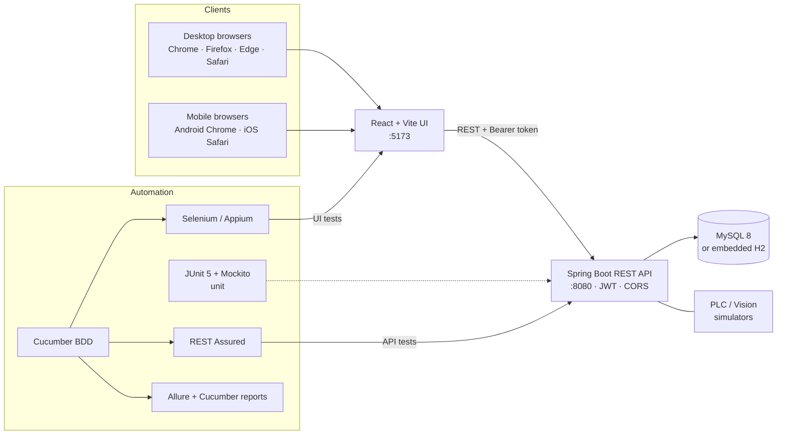
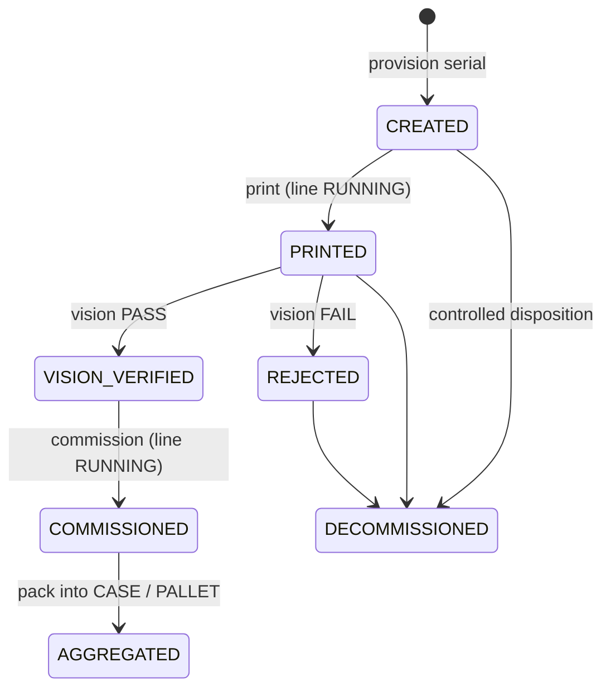

<div align="center">

# 💊 RbcTcsWorld PharmaPack QMS — Serialization & Line Control

### Pharmaceutical packaging QMS with a simulated L3 serialization line, tested end to end with Cucumber, REST Assured, Selenium and JUnit

[](https://git.io/typing-svg)

<!-- ============ STATUS BAR ============ -->
[](https://github.com/rbchy/RbcTcsWorld_PharmaPackQMS_Serialization/actions/workflows/ci.yml)

[](https://rbchy.github.io/RbcTcsWorld_PharmaPackQMS_Serialization/)


</div>

---

## 📌 At a Glance

<table>
<tr>
<td width="50%" valign="top">

**🙋 What this is**

A full-stack **pharmaceutical packaging Quality Management System** with a simulated **L3 serialization line**: PLC, printer, vision camera, scanner, reject station and UNIT → CASE → PALLET aggregation. It comes with its own test-automation framework.

It is built from hands-on GMP packaging-line experience. Batch records, AQL, reconciliation, deviations, CAPA and serialization work the way a blister-packaging floor runs them.

Every push builds the backend, loads MySQL, starts the API and the React UI, and runs all **unit, API and headless-browser tests** in GitHub Actions. The Allure report is published to GitHub Pages.

> *Portfolio / training project. It is **not** a validated GxP system (see [Disclaimer](#-disclaimer)).*

</td>
<td width="50%" valign="top">

**📍 Quick facts**

| | |
|---|---|
| 🧪 **Tests** | 27 unit · 42 Cucumber API · 4 Cucumber UI · 4 JUnit API |
| ✅ **CI** | 77 / 77 · ≈ 2 min end to end |
| 🔐 **Security** | JWT login · 5 roles · audit trail · e-signatures |
| 🖥️ **Editions** | MySQL server · standalone desktop (Windows / macOS / Linux) |
| 📊 **Reports** | Allure (live on Pages) · Cucumber HTML / JSON / JUnit |
| 🐞 **Defects found** | 6 by automation (5 fixed) |

</td>
</tr>
</table>

---

## ✅ Latest Results

| Layer | Tests | What is asserted | Result |
|---|---:|---|---|
| 🧩 Backend unit (JUnit 5 + Mockito) | 27 | Reconciliation: balanced → `RECONCILED`, shortfall or overage → `INVESTIGATION_REQUIRED` with the exact variance, audit entry written · AQL: Ac/Re boundaries → ACCEPT / REVIEW / REJECT · PLC: a faulty or offline device stops the line and blocks START |  |
| 🌐 Cucumber API (REST Assured) | 42 | Every module, with its seeded records · JWT login and 401s · full serialization chain with event history · GMP negative rules (wrong DataMatrix, no vision, stopped line, bad aggregation) · AQL 3 / 4 defect boundary · reconciliation variance |  |
| 🖥️ Cucumber UI (Selenium, headless Chrome) | 4 | Invalid and valid login · START / STOP on the HMI · new serial printed while *Commission* stays disabled before vision |  |
| 🔌 JUnit API smoke | 4 | Line status lists all 4 devices · 401 without a token · all devices READY → `RUNNING` · a FAULT device → `FAULT`, then recovers |  |
| **Total** | **77** | | **100 %** |

<sub>GitHub Actions on Ubuntu: MySQL 8 service, Temurin 21, Node 20, headless Chrome ([workflow](.github/workflows/ci.yml)). Allure report: [rbchy.github.io/RbcTcsWorld_PharmaPackQMS_Serialization](https://rbchy.github.io/RbcTcsWorld_PharmaPackQMS_Serialization/).</sub>

---

## 🏭 What It Does

| Area | Capabilities |
|---|---|
| **Master data** | Products, batches, materials, equipment, packaging lines |
| **Production** | Production runs and shift entries |
| **Quality** | AQL sampling inspections, batch reconciliation, QA review, deviations, CAPA |
| **Compliance** | Audit trail for every create and update · electronic signatures (21 CFR Part 11 concepts) · JWT login with roles: Admin, QA, Supervisor, Operator, Inspector |
| **Serialization** | Serial provisioning, printing, vision verification (DataMatrix / lot / expiry), commissioning, controlled decommissioning with reason codes, UNIT → CASE → PALLET aggregation, full event history |
| **Line control** | PLC simulator (START / STOP / FAULT / E-STOP) with printer, vision, scanner and reject-station states |
| **Operator HMI** | React UI with one tab per module and a packaging-line / serialization screen |

---

## 🏗️ Architecture



### Serialization workflow (GMP rules)



The backend enforces these rules, and an automated test covers each one:

1. Only a **PRINTED** serial can be vision-verified.
2. Only a **VISION_VERIFIED** serial (vision PASS) can be **commissioned**.
3. Print, vision and commission are line operations. They are refused with `409 Conflict` unless the PLC is `RUNNING`.
4. Only **COMMISSIONED** serials can be aggregated, and only under a higher level of the same batch (UNIT < CASE < PALLET).
5. Every step writes a serialization event (`GET /api/serialization/{serial}/events`).

---

## 🛠️ Tech Stack

| Layer | Technology |
|---|---|
| Backend | Java 21 · Spring Boot 3.5 (Web, Data JPA, Security, Validation) · JWT (jjwt 0.12) · Lombok · Flyway |
| Database | MySQL 8 (scripts in `database/`) · H2 for the desktop edition |
| Frontend | React 19 · TypeScript · Vite |
| Unit tests | JUnit 5 · Mockito (spring-boot-starter-test) |
| API tests | Cucumber 7.18 · REST Assured 5.5 · JUnit Platform |
| UI tests | Selenium 4.35 (Selenium Manager) · Appium (UiAutomator2 / XCUITest) · Selenium Grid · BrowserStack |
| Reporting | Allure 2.29 (request/response attachments, screenshots) · Cucumber HTML / JSON / JUnit XML / timeline |
| CI / CD | GitHub Actions: test pipeline + Allure on Pages · `jpackage` desktop builds for 3 operating systems |

---

## 📁 Project Structure

```
RbcTcsWorld_PharmaPackQMS_Serialization/
├── .github/workflows/
│   ├── ci.yml                 ← MySQL → backend + unit tests → UI → API + UI tests → Allure → Pages
│   └── package.yml            ← desktop apps (Windows / macOS / Linux) on demand or on a v* tag
├── backend/
│   ├── src/main/java/com/pharmapack/qms/
│   │   ├── auth/              JWT login, roles, security & CORS
│   │   ├── serialization/     workflow, vision results, events, aggregation
│   │   ├── line/              PLC / device simulator
│   │   ├── batch/ product/ master/ production/ aql/ reconciliation/
│   │   ├── qa/ deviation/ capa/ audit/ esignature/
│   │   └── desktop/           tray launcher for the desktop edition
│   └── src/test/java/         unit tests: reconciliation, AQL, line simulator
├── frontend/src/              React UI
├── database/                  schema, seed data, phase migrations, verify.sql
├── automation/                test-automation framework (own pom.xml)
│   └── src/test/
│       ├── java/…/steps/      ApiSteps, SerializationLineSteps, UiSteps, ReportHooks
│       ├── java/…/pages/      Page Objects (Login, AppShell, Serialization)
│       ├── java/…/ui/         DriverFactory, DriverManager, UiConfig
│       └── resources/features/   API features + ui/*.feature (@ui)
├── docs/                      ERD, workflow, form design, industry comparison, Bangla run guide
├── pom.xml                    backend build
└── RUNBOOK.md                 step-by-step local setup
```

---

## ⚙️ Getting Started

**Prerequisites:** JDK 21 · Maven 3.9+ · MySQL 8 · Node.js 20+

```bash
# 1. Database
mysql -u root -p < database/schema.sql
mysql -u root -p < database/seed.sql
mysql -u root -p < database/create_app_user.sql
mysql -u root -p < database/phase2-migration.sql
mysql -u root -p < database/phase3-password-update.sql
mysql -u root -p < database/phase4-systech-serialization.sql

# 2. Backend (terminal 1) — runs the unit tests on package/test
mvn spring-boot:run                     # http://localhost:8080/api

# 3. Frontend (terminal 2)
cd frontend && npm install && npm run dev   # http://localhost:5173
```

Settings can be overridden with `DB_URL`, `DB_USERNAME`, `DB_PASSWORD`, `JWT_SECRET`, `JWT_EXPIRATION_MS`, `SERVER_PORT` and `CORS_ORIGIN_PATTERNS`.

| Username | Password | Role |
|---|---|---|
| admin | admin123 | Admin |
| qa_user | qa123 | QA |
| supervisor | super123 | Supervisor |
| operator | operator123 | Operator |
| inspector | inspect123 | Inspector |

<sub>Training data only.</sub>

<details>
<summary><strong>🖥️ Desktop edition — Windows / macOS / Linux, nothing to install</strong></summary>

<br>

A standalone build of the whole app: the React UI, the Spring Boot API, an **embedded H2 database** with the demo data, and its own Java runtime.

**Get it:** open **Actions → Package desktop apps → Run workflow** and download the artifact for your OS. Pushing a tag such as `v1.0.0` also attaches the files to a GitHub **Release**.

| OS | Portable | Installer |
|---|---|---|
| Windows | `PharmaPackQMS-1.0.0-windows-portable.zip` → `PharmaPackQMS.exe` | `.msi` |
| macOS | `PharmaPackQMS-1.0.0-macos-portable.zip` → `PharmaPackQMS.app` | `.dmg` |
| Linux | `PharmaPackQMS-1.0.0-linux-portable.tar.gz` → `bin/PharmaPackQMS` | `.deb` |

- The browser opens `http://localhost:8080` by itself. Log in as `admin` / `admin123`.
- A tray icon offers **Open** and **Quit**.
- Phones and other PCs on the same Wi-Fi can use the "Other devices" address printed at startup.
- Data is kept in `~/.pharmapack-qms/`. Delete it to reset to the demo data.
- The builds are unsigned. On macOS, right-click and choose **Open**. On Windows, click **More info → Run anyway**.
- Before packaging, the workflow smoke-tests the app and runs the full API suite against the embedded database on Linux.

```bash
cd frontend && npm install && npx vite build && cd ..
mvn -DskipTests package
java -Dspring.profiles.active=desktop -jar target/pharmapack-qms-0.2.0-SNAPSHOT.jar
```

</details>

---

## 🧪 Running the Tests

Run from `automation/` with the backend running, and the frontend too for UI tests.

| Run | Command |
|---|---|
| Backend unit tests | `mvn test` (project root) |
| API suite (default) | `mvn clean test -DbaseUrl=http://localhost:8080/api` |
| UI suite, Chrome | `mvn clean test -Pui -Dplatform=chrome` |
| Everything (API + UI) | `mvn clean test -Pall -Dplatform=chrome` |
| Only GMP negative tests | `mvn clean test -Dcucumber.filter.tags="@gmp and @negative"` |
| Headless (CI) | add `-Dheadless=true` |

<details>
<summary><strong>📱 Cross-platform UI targets</strong></summary>

<br>

| Target | Command | One-time setup |
|---|---|---|
| Chrome / Firefox / Edge | `-Pui -Dplatform=chrome` (`firefox`, `edge`) | none |
| Safari (macOS) | `-Pui -Dplatform=safari` | `sudo safaridriver --enable` |
| Windows (Edge) | `-Pui -Dplatform=windows -DuiBaseUrl=http://<host>:5173 -DbaseUrl=http://<host>:8080/api` | JDK 21, Maven, Edge |
| Android (Chrome) | `-Pui -Dplatform=android` | emulator · `appium driver install uiautomator2` · `appium --allow-insecure chromedriver_autodownload` |
| iOS (Safari) | `-Pui -Dplatform=ios -Ddevice="iPhone 16"` | Xcode simulator · `appium driver install xcuitest` |
| Selenium Grid | `-Dexecution=grid -Dgrid.url=http://<grid>:4444` | a running Grid |
| BrowserStack | `-Dexecution=browserstack -Dplatform=ios` | `BROWSERSTACK_USERNAME`, `BROWSERSTACK_ACCESS_KEY` |

See [`automation/README.md`](automation/README.md). For the Bangla guide with commands for every device, see [`docs/RUN_GUIDE_BN.md`](docs/RUN_GUIDE_BN.md).

</details>

**Framework design**
- `ApiAuth` logs in once and reuses the JWT. Every Cucumber scenario logs in as `admin` in a `@Before` hook.
- `{{variables}}` carry values between steps, for example a new batch id. `{{ts}}` makes record numbers unique.
- `@After("@stops-line")` restarts the line, so scenarios do not depend on each other.
- UI Page Objects use `data-testid` locators and explicit waits. `ThreadLocal` WebDrivers are ready for parallel runs.
- Allure categories separate product defects (5xx, broken GMP rules) from environment problems and test-code problems.

---

## 🐞 Defects Found by Automation

| ID | Severity | Defect | Status |
|---|---|---|---|
| DEF-01 | **Critical (GMP)** | A serial could be commissioned from `PRINTED` without a vision PASS | Fixed, covered by API and UI tests |
| DEF-02 | High | `/serialization/{sn}/vision` and `/events` returned 500 (lazy loading outside the session) | Fixed, `@EntityGraph` |
| DEF-03 | Medium | Vision verification accepted a serial that had never been printed | Fixed, returns 400 |
| DEF-04 | Medium | Print and commission were allowed while the line was STOPPED or FAULTED | Fixed, returns 409 |
| DEF-05 | High | **START LINE** blanked the UI, because the state update dropped `devices` | Fixed, covered by a UI test |
| DEF-06 | Low | The serialized-units table does not refresh after generating serials unless a batch is already selected | Open |

In each case the test was written first and failed (red); the fix was then verified (green).

---

## 🧹 Maintenance Log

| Change | Why |
|---|---|
| Real backend unit tests for `ReconciliationController`, `AqlController` and `LineSimulatorService` (27 tests) | The only unit test, `ReconciliationCalculatorTest`, did BigDecimal sums inside the test and never called the application |
| *"the QMS API is running"* now asserts HTTP 200 | It fetched `/api/products` but checked nothing |
| List endpoints check their seeded records (PMP-001, BATCH-DEMO-001, MAT-001, EQ-001, LINE-01/02, AQL-II-1.0) | Products, batches, materials, equipment and lines only checked *status 200 and JSON* |
| New API scenarios: AQL 3 → ACCEPT / 4 → REJECT, and a reconciliation with 3 units unaccounted for → `INVESTIGATION_REQUIRED` | Only the "happy" result of each calculation was tested |
| Line smoke test expects `RUNNING`; a new test proves a FAULT device stops the line | It accepted `RUNNING` **or** `FAULT`, so it could not fail |
| CI runs on every branch push | It ran only on `main` and on pull requests |
| Frontend dependencies pinned (React 19.3, Vite 8.3, TypeScript 7.0) | `package.json` asked for `latest`, so a new major release could break the build at any time |

---

## 📈 Roadmap

> **Unified platform design (EN + বাংলা):** [`docs/unified-platform/README.md`](docs/unified-platform/README.md). It merges this repo, PharmaPackQMS and PPES (Pharmaceutical PMC) into one suite.

- [x] GitHub Actions: MySQL service, backend, headless UI, Allure published to GitHub Pages
- [x] Backend unit tests run in the pipeline
- [ ] Unit tests for `SerializationWorkflowService` (state machine) and `BatchService`
- [ ] Per-scenario test data for fully isolated, parallel runs
- [ ] JDBC-level checks of `serialized_units`, `serialization_events`, `vision_results`
- [ ] More UI coverage: vision simulator, decommission and aggregation screens
- [ ] Android and iOS runs in CI via BrowserStack
- [ ] Fix DEF-06

---

## 🔗 Related Projects

| Project | Stack |
|---|---|
| ⭐ [RbcTcsWorld E-Commerce Suite](https://github.com/rbchy/RbcTcsWorld_ECommerceSuite) | Spring Boot · REST Assured · Selenium · Playwright · CI quality gates |
| 🧬 [RbcTcsWorld ClinTrial Connect](https://github.com/rbchy/RbcTcsWorld_ClinTrial-Connect) | Clinical-trial platform with its own test suite |
| 🏥 [OpenEMR Healthcare](https://github.com/rbchy/OpenEMR_Automation) | Java · Selenium · Cucumber · TestNG, CI green |
| 🧾 [OrangeHRM Payroll Automation](https://github.com/rbchy/OrangeHRM_TestAutomation_TestNG_Junit5) | JUnit 5 · TestNG · REST Assured · WireMock |

<sub>All projects: [github.com/rbchy](https://github.com/rbchy)</sub>

---

## ⚠️ Disclaimer

This is a **portfolio / training simulation**. It is inspired by publicly documented industry concepts: DSCSA / EU-FMD serialization, L3 line management and aggregation. It is **not** a copy of any vendor's software and **not** a validated GxP system.

A real GMP deployment would need:

- computer-system validation (IQ/OQ/PQ)
- change control and data-integrity controls
- a security review, backup and recovery
- alignment with site SOPs and market-specific regulations

All credentials and secrets in this repository are demo values.

---

## 👤 Author

<div align="center">

**Ranajit Baran Chowdhury (RB Chowdhury)**
QA Automation Engineer / SDET · Pharmaceutical Packaging Production (GMP) · West Norriton, Pennsylvania, USA

[](https://www.linkedin.com/in/rbchy/)
[](https://github.com/rbchy)
[](https://rbchy.github.io/rbchy/)
[](https://rbc6543.wixsite.com/rbc-portfolio)
[](mailto:chyranajit@gmail.com)

⭐ *If this project helps you, a star on the repo is appreciated.*

</div>
